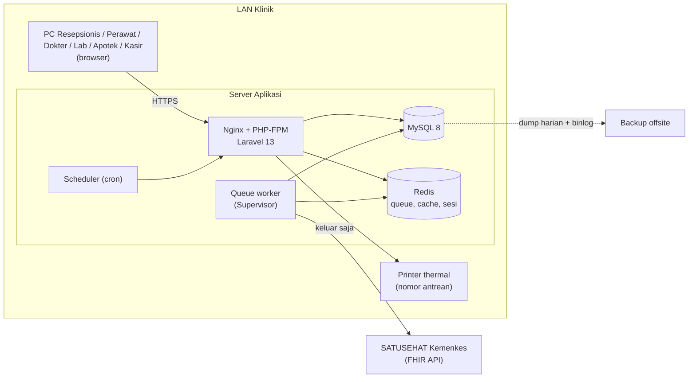
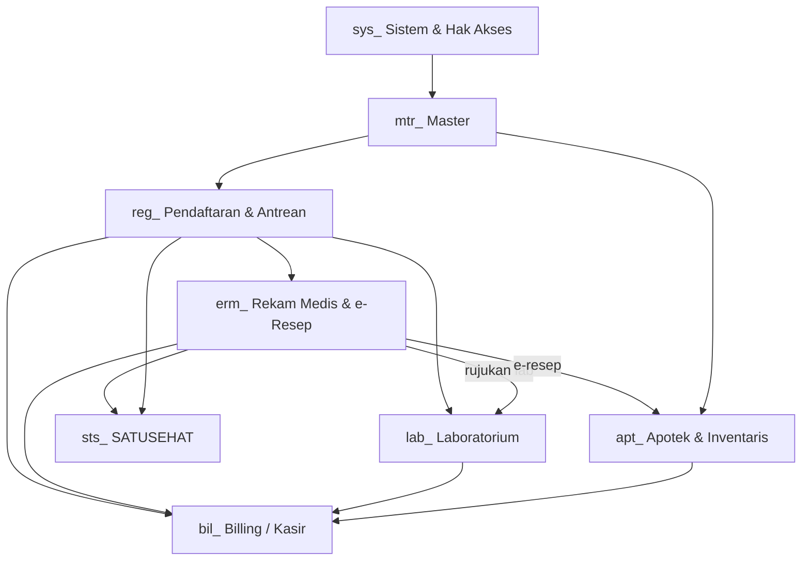
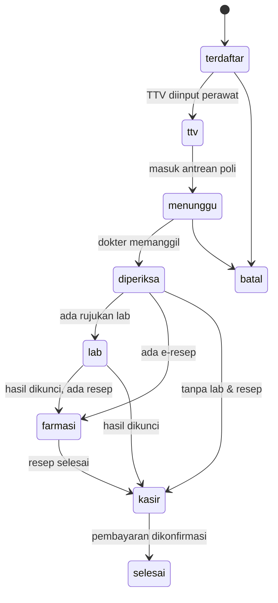
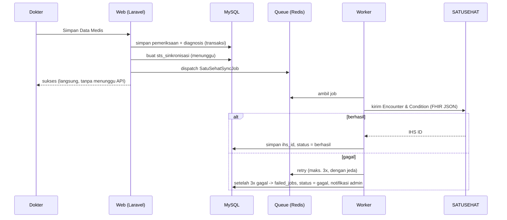

# Arsitektur — SIM Klinik Avicena

## 1. Tujuan arsitektur
Aplikasi web monolit (Laravel) yang dipakai di LAN klinik: cepat (< 2 detik per halaman), tahan gangguan internet (data medis selalu tersimpan lokal dulu), dan patuh (sinkron ke SATUSEHAT secara asinkron).

## 2. Gambaran sistem

Koneksi internet hanya dibutuhkan **keluar** (worker → SATUSEHAT, backup). Kalau internet putus, klinik tetap beroperasi; job akan di-retry.

## 3. Infrastruktur
| Komponen | Pilihan | Catatan |
|---|---|---|
| Web | Nginx + PHP-FPM (versi PHP sesuai syarat Laravel 13) | HTTPS dengan sertifikat internal |
| Database | MySQL 8, InnoDB, `utf8mb4_unicode_ci` | enkripsi disk (LUKS) + kolom sensitif `encrypted` |
| Queue/cache/sesi | Redis | queue khusus `satusehat` dipisah dari `default` |
| Proses | Supervisor menjalankan `queue:work --queue=satusehat,default` | restart otomatis; Laravel Horizon opsional |
| Scheduler | cron `* * * * * php artisan schedule:run` | cek kedaluwarsa obat, stok minimum, token SATUSEHAT |
| Backup | dump harian + binlog + salinan offsite terenkripsi | uji restore berkala |
| Perangkat | UPS server, printer thermal, (opsional) layar TV antrean | |
| Jaringan | firewall: hanya 443 ke LAN; SSH dibatasi | |

## 4. Arsitektur aplikasi (berlapis)
```
Request → Route → Middleware (auth, izin) → Controller (tipis)
       → FormRequest (validasi) → Service (logika bisnis, transaksi)
       → Model/Eloquent → MySQL
                      → Job (queue) → API SATUSEHAT
Response ← Blade (AdminLTE 4)
```
- **Controller**: hanya orkestrasi. Tidak ada aturan bisnis.
- **Service**: satu-satunya tempat aturan bisnis & `DB::transaction`. Contoh: `AntreanService`, `PendaftaranService`, `StokService`, `RacikanService`, `TagihanService`, `PembayaranService`, `LabService`.
- **Policy**: aturan tingkat data (pemilik, status terkunci). Izin menu ditangani `izin:*` middleware (lihat `permissions.md`).
- **Job**: pekerjaan latar belakang; idempotent (aman dijalankan ulang).

## 5. Struktur folder
```
app/
  Console/Commands/SinkronMenu.php
  Http/Controllers/{Master,Registrasi,Erm,Lab,Apotek,Billing,SatuSehat,Sistem}/
  Http/Middleware/PeriksaIzin.php
  Http/Requests/<Ns>/
  Jobs/SatuSehat/
  Models/{Sys,Master,Registrasi,Erm,Lab,Apotek,Billing,SatuSehat}/ + ModelDasar.php
  Policies/
  Providers/MenuServiceProvider.php
  Services/{Registrasi,Erm,Lab,Apotek,Billing,SatuSehat}/ + IzinService.php
config/menu.php
database/{migrations,seeders}/
resources/views/{layouts,<ns>}/
docs/
```

## 6. Modul & ketergantungan

Urutan pengerjaan mengikuti panah (lihat `roadmap.md`).

## 7. Siklus hidup kunjungan

Lab mandiri dan apotek umum membuat kunjungan sendiri (`jenis_kunjungan = lab_mandiri | apotek_umum`) dan melewati TTV/poli. Catatan desain tentang lab + farmasi paralel ada di `business-rules.md` §1.

## 8. Alur simpan data medis → SATUSEHAT


## 9. Keamanan
- RBAC: peran → hak menu (lihat/tambah/ubah/hapus) di `sys_hak_akses`; Policy untuk data.
- Enkripsi: disk, kolom `nik` & `token` (`encrypted` cast), `nik_hash` HMAC untuk pencarian.
- Audit: aksi penting ke `sys_log_aktivitas` (siapa, apa, nilai lama/baru, IP).
- Kata sandi di-hash (`hashed` cast); sesi di Redis; throttle login.
- Log aplikasi tidak boleh memuat NIK/hasil lab/SOAP. Payload FHIR di `sts_sinkronisasi` diperlakukan sebagai data sensitif.
- Rahasia (client id/secret SATUSEHAT, `APP_KEY`, kunci HMAC NIK) hanya di `.env`.

## 10. Performa
- Target: halaman < 2 detik di LAN. Eager loading, `paginate()`, indeks sesuai `database.md`.
- Pencarian pasien: indeks `nik_hash`, `no_rekam_medis`, `nama_lengkap`.
- Stok: indeks `(obat_id, tanggal_kedaluwarsa)` untuk FEFO; transaksi singkat.
- Dashboard antrean memakai polling ringan (bukan websocket) di fase awal.

## 11. Konfigurasi lingkungan (`.env`)
```
APP_TIMEZONE=Asia/Jakarta
APP_LOCALE=id
DB_CONNECTION=mysql
QUEUE_CONNECTION=redis
CACHE_STORE=redis
SESSION_DRIVER=redis
NIK_HMAC_KEY=            # kunci HMAC untuk nik_hash (jangan pernah diganti setelah ada data)
SATUSEHAT_ENV=sandbox    # sandbox | production
SATUSEHAT_CLIENT_ID=
SATUSEHAT_CLIENT_SECRET=
SATUSEHAT_ORGANIZATION_ID=
```

## 12. Observability & operasional
- Pantau: antrean `satusehat` (Horizon/dashboard), `failed_jobs`, kapasitas disk, kesehatan MySQL, uptime.
- Deploy: `composer install --no-dev` → `php artisan migrate --force` → `php artisan menu:sinkron` → `php artisan queue:restart` → cache config/route/view.
