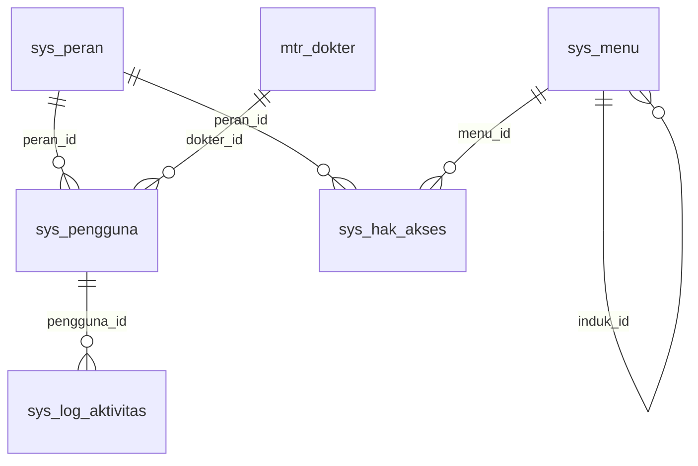
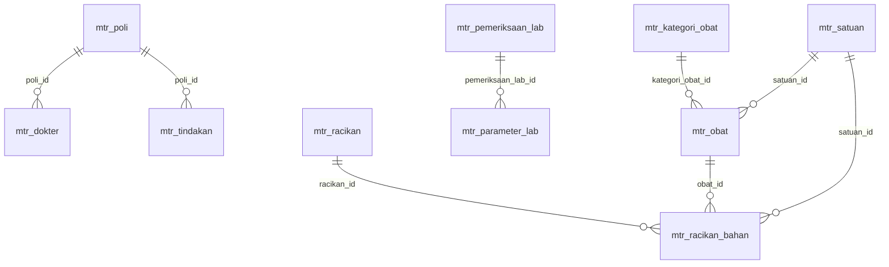
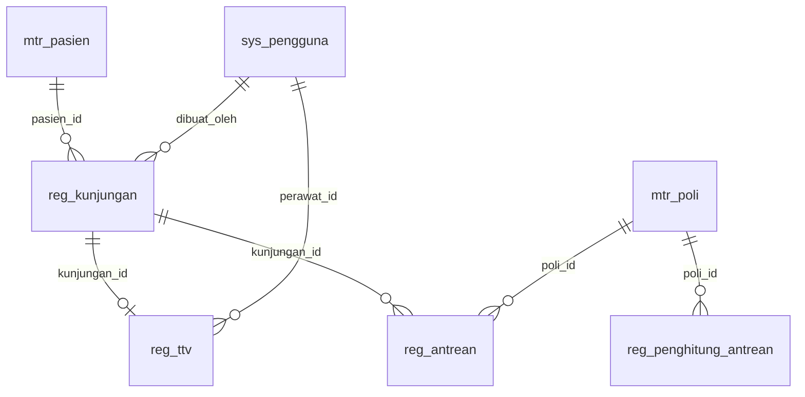
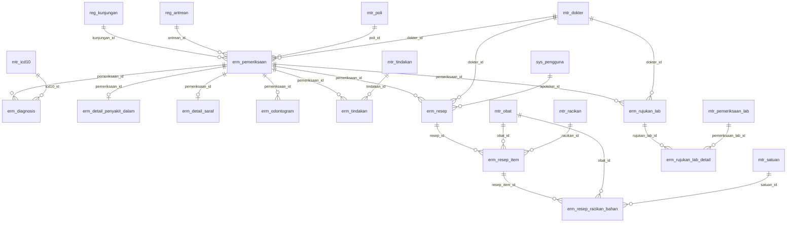
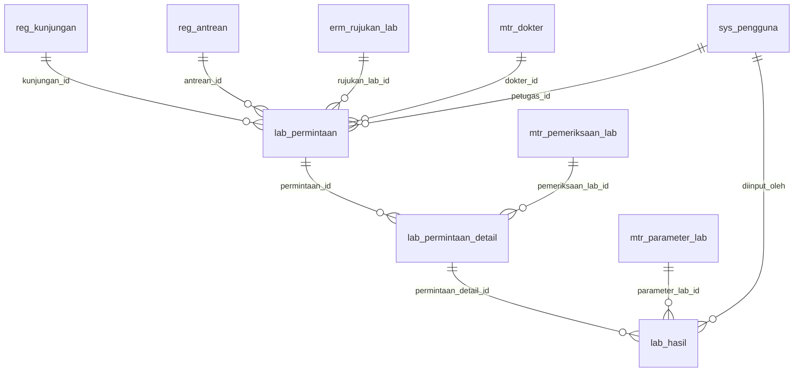
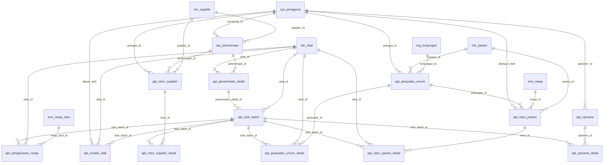
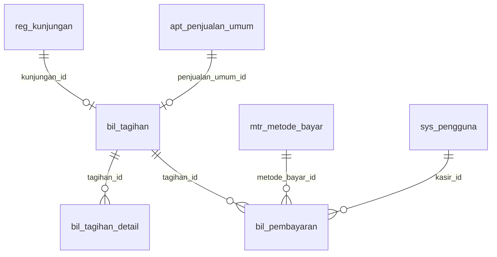

# Database — SIM Klinik Avicena

- **56 tabel**, MySQL 8, InnoDB, `utf8mb4_unicode_ci`.
- Sumber kebenaran: folder `database/migrations/` (snapshot awal di `docs/schema.sql`; ERD & daftar di bawah dihasilkan dari snapshot itu — periksa migration jika ada perbedaan).
- Konvensi: prefix modul + nama Indonesia; `created_at/updated_at/deleted_at` standar Laravel; `deleted_at` hanya master & `sys_pengguna`.
- Kolom lengkap: lihat `docs/schema.sql` atau migration. Dokumen ini fokus pada peta, relasi, dan aturan.

## Prefix ↔ namespace model
| Prefix | Namespace | Jumlah tabel |
|---|---|---|
| `sys_` | `App\Models\Sys` | 6 |
| `mtr_` | `App\Models\Master` | 14 |
| `reg_` | `App\Models\Registrasi` | 4 |
| `erm_` | `App\Models\Erm` | 11 |
| `lab_` | `App\Models\Lab` | 3 |
| `apt_` | `App\Models\Apotek` | 13 |
| `bil_` | `App\Models\Billing` | 3 |
| `sts_` | `App\Models\SatuSehat` | 2 |

> Catatan: tabel `sys_pengguna` memakai model `App\Models\User` (extends `Authenticatable`, atribut `#[Table('sys_pengguna')]`), bukan `App\Models\Sys\Pengguna` (lihat `decisions.md` D14).

## Peta relasi per modul
Panah: induk ||--o{ anak (satu-ke-banyak); `||--o|` = satu-ke-satu. Tabel modul lain yang dirujuk ikut tampil tanpa atribut.

### sys_ — Sys
Pengguna, peran, menu, hak akses, log aktivitas, dan pengaturan sistem. `sys_menu` disinkron dari `config/menu.php`; `sys_hak_akses` = peran × menu × (lihat/tambah/ubah/hapus).

| Tabel | Induk (FK) | Unik |
|---|---|---|
| `sys_peran` | — | (nama) |
| `sys_pengguna` | `peran_id`→`sys_peran`, `dokter_id`→`mtr_dokter` | (username); (email) |
| `sys_menu` | `induk_id`→`sys_menu` | (kode) |
| `sys_hak_akses` | `peran_id`→`sys_peran`, `menu_id`→`sys_menu` | (peran_id, menu_id) |
| `sys_log_aktivitas` | `pengguna_id`→`sys_pengguna` | — |
| `sys_pengaturan` | — | (kunci) |

### mtr_ — Master
Data master: pasien, poli, dokter, ICD-10, tindakan, obat (+kategori, satuan), supplier, pemeriksaan & parameter lab, template racikan, metode bayar. `mtr_pasien.nik` terenkripsi, `nik_hash` untuk pencarian.

| Tabel | Induk (FK) | Unik |
|---|---|---|
| `mtr_poli` | — | (kode) |
| `mtr_dokter` | `poli_id`→`mtr_poli` | — |
| `mtr_pasien` | — | (no_rekam_medis); (nik_hash) |
| `mtr_icd10` | — | (kode) |
| `mtr_tindakan` | `poli_id`→`mtr_poli` | (kode) |
| `mtr_kategori_obat` | — | (nama) |
| `mtr_satuan` | — | (nama) |
| `mtr_obat` | `kategori_obat_id`→`mtr_kategori_obat`, `satuan_id`→`mtr_satuan` | (kode) |
| `mtr_supplier` | — | — |
| `mtr_pemeriksaan_lab` | — | (kode) |
| `mtr_parameter_lab` | `pemeriksaan_lab_id`→`mtr_pemeriksaan_lab` | — |
| `mtr_racikan` | — | — |
| `mtr_racikan_bahan` | `racikan_id`→`mtr_racikan`, `obat_id`→`mtr_obat`, `satuan_id`→`mtr_satuan` | (racikan_id, obat_id) |
| `mtr_metode_bayar` | — | (nama) |

### reg_ — Registrasi
Kunjungan, TTV, antrean per poli, dan penghitung nomor antrean harian. `reg_kunjungan` adalah poros: hampir semua tabel transaksi bergantung padanya.

| Tabel | Induk (FK) | Unik |
|---|---|---|
| `reg_kunjungan` | `pasien_id`→`mtr_pasien`, `dibuat_oleh`→`sys_pengguna` | (no_kunjungan) |
| `reg_ttv` | `kunjungan_id`→`reg_kunjungan`, `perawat_id`→`sys_pengguna` | (kunjungan_id) |
| `reg_penghitung_antrean` | `poli_id`→`mtr_poli` | (poli_id, tanggal) |
| `reg_antrean` | `kunjungan_id`→`reg_kunjungan`, `poli_id`→`mtr_poli` | (poli_id, tanggal, nomor_urut) |

### erm_ — Erm
Pemeriksaan SOAP, diagnosis ICD-10, form khusus (penyakit dalam, saraf), odontogram, tindakan, e-resep (+item & bahan racikan), rujukan lab.

| Tabel | Induk (FK) | Unik |
|---|---|---|
| `erm_pemeriksaan` | `kunjungan_id`→`reg_kunjungan`, `antrean_id`→`reg_antrean`, `poli_id`→`mtr_poli`, `dokter_id`→`mtr_dokter` | — |
| `erm_diagnosis` | `pemeriksaan_id`→`erm_pemeriksaan`, `icd10_id`→`mtr_icd10` | — |
| `erm_detail_penyakit_dalam` | `pemeriksaan_id`→`erm_pemeriksaan` | (pemeriksaan_id) |
| `erm_detail_saraf` | `pemeriksaan_id`→`erm_pemeriksaan` | (pemeriksaan_id) |
| `erm_odontogram` | `pemeriksaan_id`→`erm_pemeriksaan` | — |
| `erm_tindakan` | `pemeriksaan_id`→`erm_pemeriksaan`, `tindakan_id`→`mtr_tindakan` | — |
| `erm_resep` | `pemeriksaan_id`→`erm_pemeriksaan`, `dokter_id`→`mtr_dokter`, `apoteker_id`→`sys_pengguna` | (no_resep) |
| `erm_resep_item` | `resep_id`→`erm_resep`, `obat_id`→`mtr_obat`, `racikan_id`→`mtr_racikan` | — |
| `erm_resep_racikan_bahan` | `resep_item_id`→`erm_resep_item`, `obat_id`→`mtr_obat`, `satuan_id`→`mtr_satuan` | — |
| `erm_rujukan_lab` | `pemeriksaan_id`→`erm_pemeriksaan`, `dokter_id`→`mtr_dokter` | — |
| `erm_rujukan_lab_detail` | `rujukan_lab_id`→`erm_rujukan_lab`, `pemeriksaan_lab_id`→`mtr_pemeriksaan_lab` | (rujukan_lab_id, pemeriksaan_lab_id) |

### lab_ — Lab
Permintaan lab (rujukan/mandiri, dokter lab penanggung jawab), detail pemeriksaan, dan hasil per parameter. Hasil dikunci lalu masuk tagihan.

| Tabel | Induk (FK) | Unik |
|---|---|---|
| `lab_permintaan` | `kunjungan_id`→`reg_kunjungan`, `antrean_id`→`reg_antrean`, `rujukan_lab_id`→`erm_rujukan_lab`, `dokter_id`→`mtr_dokter`, `petugas_id`→`sys_pengguna` | (no_permintaan) |
| `lab_permintaan_detail` | `permintaan_id`→`lab_permintaan`, `pemeriksaan_lab_id`→`mtr_pemeriksaan_lab` | (permintaan_id, pemeriksaan_lab_id) |
| `lab_hasil` | `permintaan_detail_id`→`lab_permintaan_detail`, `parameter_lab_id`→`mtr_parameter_lab`, `diinput_oleh`→`sys_pengguna` | (permintaan_detail_id, parameter_lab_id) |

### apt_ — Apotek
Obat masuk (faktur/bets/kedaluwarsa), stok per batch, buku besar mutasi stok, pengeluaran resep, penjualan umum, retur supplier/pasien, stock opname.

| Tabel | Induk (FK) | Unik |
|---|---|---|
| `apt_penerimaan` | `supplier_id`→`mtr_supplier`, `penerima_id`→`sys_pengguna` | (supplier_id, no_faktur) |
| `apt_penerimaan_detail` | `penerimaan_id`→`apt_penerimaan`, `obat_id`→`mtr_obat` | — |
| `apt_stok_batch` | `obat_id`→`mtr_obat`, `penerimaan_detail_id`→`apt_penerimaan_detail` | — |
| `apt_mutasi_stok` | `stok_batch_id`→`apt_stok_batch`, `obat_id`→`mtr_obat`, `dibuat_oleh`→`sys_pengguna` | — |
| `apt_pengeluaran_resep` | `resep_item_id`→`erm_resep_item`, `obat_id`→`mtr_obat`, `stok_batch_id`→`apt_stok_batch` | — |
| `apt_penjualan_umum` | `kunjungan_id`→`reg_kunjungan`, `pasien_id`→`mtr_pasien`, `petugas_id`→`sys_pengguna` | (no_penjualan) |
| `apt_penjualan_umum_detail` | `penjualan_id`→`apt_penjualan_umum`, `obat_id`→`mtr_obat`, `stok_batch_id`→`apt_stok_batch` | — |
| `apt_retur_supplier` | `supplier_id`→`mtr_supplier`, `penerimaan_id`→`apt_penerimaan`, `petugas_id`→`sys_pengguna` | (no_retur) |
| `apt_retur_supplier_detail` | `retur_id`→`apt_retur_supplier`, `stok_batch_id`→`apt_stok_batch` | — |
| `apt_retur_pasien` | `pasien_id`→`mtr_pasien`, `resep_id`→`erm_resep`, `penjualan_id`→`apt_penjualan_umum`, `disetujui_oleh`→`sys_pengguna` | (no_retur) |
| `apt_retur_pasien_detail` | `retur_id`→`apt_retur_pasien`, `obat_id`→`mtr_obat`, `stok_batch_id`→`apt_stok_batch` | — |
| `apt_opname` | `apoteker_id`→`sys_pengguna` | (no_opname) |
| `apt_opname_detail` | `opname_id`→`apt_opname`, `stok_batch_id`→`apt_stok_batch` | (opname_id, stok_batch_id) |

### bil_ — Billing
Tagihan konsolidasi per kunjungan/penjualan, detail per komponen, dan pembayaran.

| Tabel | Induk (FK) | Unik |
|---|---|---|
| `bil_tagihan` | `kunjungan_id`→`reg_kunjungan`, `penjualan_umum_id`→`apt_penjualan_umum` | (no_tagihan); (kunjungan_id); (penjualan_umum_id) |
| `bil_tagihan_detail` | `tagihan_id`→`bil_tagihan` | — |
| `bil_pembayaran` | `tagihan_id`→`bil_tagihan`, `metode_bayar_id`→`mtr_metode_bayar`, `kasir_id`→`sys_pengguna` | — |

### sts_ — SatuSehat
Status sinkronisasi SATUSEHAT per resource dan token akses.

_Tidak ada relasi foreign key (tabel berdiri sendiri)._

| Tabel | Induk (FK) | Unik |
|---|---|---|
| `sts_sinkronisasi` | — | — |
| `sts_token` | — | — |

## Aturan yang TIDAK ditegakkan database (wajib di Service/Policy/tes)
| Aturan | Tabel/kolom |
|---|---|
| `obat_id` wajib jika `jenis = reguler`; racikan wajib punya bahan | `erm_resep_item`, `erm_resep_racikan_bahan` |
| Tepat satu dari `kunjungan_id` / `penjualan_umum_id` terisi | `bil_tagihan` |
| `dokter_id` wajib saat daftar (mandiri) / sebelum kunci (rujukan) | `lab_permintaan` |
| Transisi status kunjungan hanya yang sah | `reg_kunjungan.status` |
| `jumlah_sisa` batch = Σ `apt_mutasi_stok.jumlah`; hanya diubah `StokService` | `apt_stok_batch`, `apt_mutasi_stok` |
| Stok hanya keluar dari batch belum kedaluwarsa (FEFO) | `apt_stok_batch` |
| Data terkunci tidak boleh diubah | `erm_pemeriksaan.dikunci`, `lab_permintaan.dikunci` |
| `total = subtotal − diskon`; tagihan lunas bila Σ pembayaran ≥ total | `bil_tagihan`, `bil_pembayaran` |
| Retur pasien hanya jika `sys_pengaturan.retur_pasien_diizinkan = 1` | `apt_retur_pasien` |
| Tarif/harga disnapshot saat transaksi | `erm_tindakan.tarif`, `lab_permintaan_detail.tarif`, `erm_resep_item.harga_satuan`, `bil_tagihan_detail` |

Satu-satunya constraint `CHECK` di DB: `apt_stok_batch.jumlah_sisa >= 0`.

## Indeks penting untuk performa
- `mtr_pasien`: unik `nik_hash`, unik `no_rekam_medis`, indeks `nama_lengkap`
- `reg_antrean`: unik `(poli_id, tanggal, nomor_urut)`; indeks `(poli_id, tanggal, status)` untuk layar antrean
- `reg_kunjungan`: indeks `(tanggal_kunjungan, status)`
- `apt_stok_batch`: indeks `(obat_id, tanggal_kedaluwarsa)` untuk FEFO
- `apt_mutasi_stok`: `(obat_id, created_at)`, `(referensi_tipe, referensi_id)`
- `sts_sinkronisasi`: `(status, jenis_resource)` untuk monitor & re-sync

## Kolom sensitif
| Kolom | Perlakuan |
|---|---|
| `mtr_pasien.nik`, `mtr_dokter.nik`, `sts_token.token` | cast `encrypted` |
| `mtr_pasien.nik_hash` | HMAC-SHA256 dengan `NIK_HMAC_KEY` (jangan ganti kunci setelah ada data) |
| `sys_pengguna.password` | cast `hashed` (nama bawaan Laravel) |
| `sts_sinkronisasi.payload/respons` | data pribadi — jangan di-log |

## Seed awal
`DataAwalSeeder`: peran (admin, resepsionis, perawat, dokter, petugas_lab, apoteker, kasir), poli (INT, GIG, SRF, LAB), metode bayar, pengaturan (`biaya_jasa_racik`, `retur_pasien_diizinkan`, `batas_peringatan_kedaluwarsa_hari`), akun `admin`. `HakAksesAwalSeeder`: menu (`menu:sinkron`) + hak per peran.
